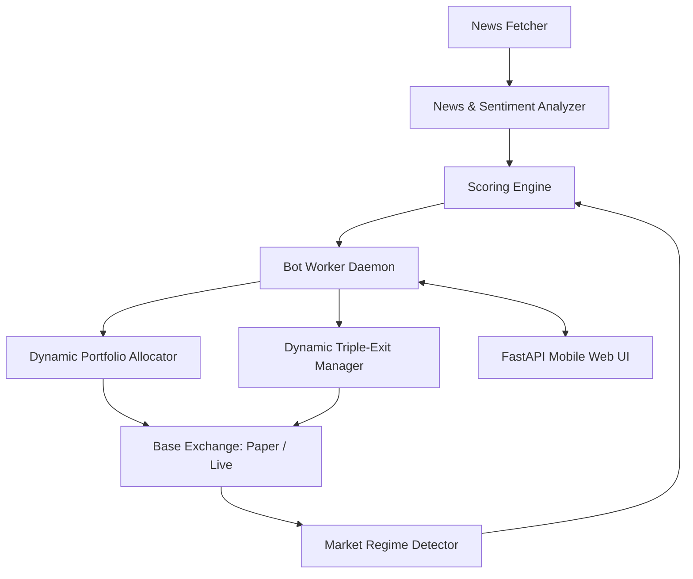

# Living Memory & Project State Tracking: Binance News Scalper

## 1. Locked Working Modules (قائمة الخطوط الحمراء)
- [x] **Architecture Specification:** Spot trading only, zero leverage, high capital velocity.
- [x] **Multi-Factor Scoring Engine:** Market Regime + Momentum + Volume Spike + News Sentiment with strict Bull Trap protection.
- [x] **Dynamic Portfolio Allocator:** Dynamically sizes slots according to liquid USDT and Binance Min Notional ($5 USDT):
  - $10 balance -> 2 slots of $5 each.
  - $15 balance -> 3 slots of $5 each.
  - Scales automatically up to 5 slots.
- [x] **Dynamic Triple-Exit Manager:** Trailing Take-Profit (+1.2% activation, 0.4% trailing offset), Hard Stop-Loss (-0.9%), and Time-Out (20 mins recycling).
- [x] **Dual-Mode Exchange Layer:**
  - `PaperExchange`: Live price feeds without credentials, simulated 0.1% spot fees.
  - `LiveExchange`: CCXT Binance Spot interface with full error shielding.
- [x] **News Radar & NLP Analyzer:** Real-time crypto feeds (CryptoPanic/RSS) with regex ticker extraction and sentiment scoring.
- [x] **24/7 Background Trading Worker:** Independent daemon running continuously regardless of client connection.
- [x] **Mobile PWA Dashboard:** Dark mode, responsive web UI with one-click toggles and emergency exit.
- [x] **100-Line Modularity Compliance:** 100% of codebase files strictly <= 100 lines.
- [x] **Automated Test Suite:** 16 unit and regression tests passing with 100% success rate.
- [x] **Cloud-Native Deployment:** `Dockerfile` and `Procfile` ready for Koyeb/Oracle/VPS.

## 2. Cumulative Requirements Registry (سجل المتطلبات التراكمية)
1. **Spot Only:** No leverage, zero liquidation risk.
2. **Capital Velocity:** Swift turnover with 20-minute maximum trade life.
3. **News + Technical Confirmation:** Never buy on headlines alone; require Wyckoff regime and volume surge confirmation.
4. **Dynamic Sizing ($5 Min Notional):** Respects Binance limits, auto-calculates concurrent slots.
5. **Dual Mode:** Paper trading default, toggleable to Live.
6. **Mobile Independence:** Continues executing in cloud even when phone is powered off.
7. **Mobile Web UI:** Accessible from phone browser as PWA with live refresh.

## 3. Dependency Map

## 4. Active Sprint Status
- **Completed:** All core modules, test suites, web server, and cloud configs.
- **Verification:** 16/16 unit tests passed, application startup verified.
- **Next Step:** Ready for user review and live cloud deployment guidance.
