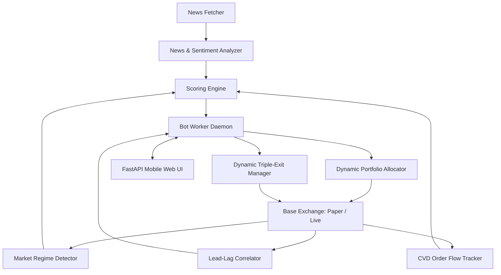

# Living Memory & Project State Tracking: Binance News Scalper

## 1. Locked Working Modules (قائمة الخطوط الحمراء)
- [x] **Lead-Lag Cross-Asset Correlator (`src/core/lead_lag_correlator.py`):** Latency arbitrage exploiting sector lag (SOL->JUP/RAY, FET->RENDER/NEAR, BTC->ETH/SOL).
- [x] **Cumulative Volume Delta Tracker (`src/core/cvd_tracker.py`):** Aggressive taker buy/sell order flow analysis, rejecting spoofing.
- [x] **Multi-Factor Scoring Engine (`src/core/scoring_engine.py`):** Market Regime + Momentum + Volume Spike + News Sentiment + CVD Order Flow with strict Bull Trap protection.
- [x] **Dynamic Portfolio Allocator (`src/core/portfolio_allocator.py`):** Dynamically sizes slots according to liquid USDT and Binance Min Notional ($5 USDT):
  - $10 balance -> 2 slots of $5 each.
  - $15 balance -> 3 slots of $5 each.
  - Scales automatically up to 5 slots.
- [x] **Dynamic Triple-Exit Manager (`src/core/risk_manager.py`):** Trailing Take-Profit (+1.2% activation, 0.4% trailing offset), Hard Stop-Loss (-0.9%), and Time-Out (20 mins recycling).
- [x] **Dual-Mode Exchange Layer (`src/exchange/`):**
  - `PaperExchange`: Live price feeds without credentials, simulated 0.1% spot fees.
  - `LiveExchange`: CCXT Binance Spot interface with full error shielding.
- [x] **News Radar & NLP Analyzer (`src/news/`):** Real-time crypto feeds with regex ticker extraction and sentiment scoring.
- [x] **24/7 Background Trading Worker (`src/engine/`):** Independent daemon running continuously regardless of client connection.
- [x] **Mobile PWA Dashboard (`src/web/`):** Dark mode, responsive web UI with one-click toggles and emergency exit.
- [x] **100-Line Modularity Compliance:** 100% of codebase files strictly <= 100 lines.
- [x] **Automated Test Suite:** 22 unit and regression tests passing with 100% success rate.
- [x] **Cloud-Native Deployment:** `Dockerfile`, `Procfile`, and `koyeb.yaml` configured for Frankfurt (fra) deployment.

## 2. Cumulative Requirements Registry (سجل المتطلبات التراكمية)
1. **Spot Only:** No leverage, zero liquidation risk.
2. **Capital Velocity:** Swift turnover with 20-minute maximum trade life.
3. **News + Technical Confirmation:** Never buy on headlines alone; require Wyckoff regime and volume surge confirmation.
4. **Institutional Quant Edge:**
   - Lead-Lag cross-asset latency arbitrage.
   - Real-time Cumulative Volume Delta (CVD) order flow tracking to bypass spoofing.
5. **Dynamic Sizing ($5 Min Notional):** Respects Binance limits, auto-calculates concurrent slots.
6. **Dual Mode:** Paper trading default, toggleable to Live.
7. **Mobile Independence:** Continues executing in cloud even when phone is powered off.
8. **Mobile Web UI:** Accessible from phone browser as PWA with live refresh.

## 3. Dependency Map

## 4. Active Sprint Status
- **Status:** All core and advanced quant modules implemented and verified.
- **Verification:** 22/22 unit tests passed. Git repository initialized and committed.
- **Ready for Cloud Push:** Ready to connect to GitHub remote and auto-deploy to Koyeb Frankfurt.
